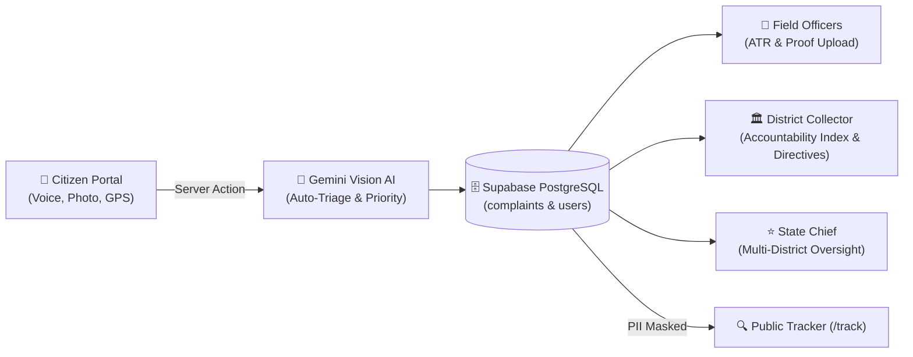

# 🏛️ AI Grievance System — Civic Triage & Executive Decision Platform

An enterprise-grade, AI-powered civic grievance reporting, triage, and administrative accountability platform built with **Next.js 16 (App Router + Server Actions)**, **TypeScript**, **PostgreSQL / Supabase**, **Google Gemini Vision AI**, and an optional **Java Spring Boot 3.2** backend service.

---

## ✨ Key Highlights

### 1. 🤖 Multimodal Citizen Filing & AI Triage (`/`, `/track`)
- **Gemini Vision AI Analysis**: Automatically inspects uploaded photo evidence to classify department, severity priority, and actionable reasoning.
- **Multilingual Voice & GPS Input**: Supports voice-to-text grievance filing and automatic reverse-geocoded GPS location tagging.
- **Live Public Tracker (`/track`)**: Real-time grievance timeline with **PII email masking** (`r***r@gmail.com`), Citizen Evidence preview, Action Taken Reports (ATR), and official District Collector Directive banners.

### 2. 🏛️ District Collector Executive Suite (`/admin`)
- **Department Accountability Index**: Real-time vertical performance matrix with animated clearance velocity bars across all 5 municipal departments (*Environment, Infrastructure & Utilities, Public Health, Police & Public Safety, District Administration*) and **1-click interactive table filtering**.
- **Collector Executive Directives (`#DIR-2026`)**: District Magistrates can issue 24-hour / 48-hour expedite mandates that auto-escalate priority to `Critical` and propagate across both the Authority Dashboard and Citizen Tracker.
- **Department Re-Assignment**: 1-click cross-department transfer for misrouted cases.

### 3. 👥 Live District Officers Duty Roster (`/admin/officers`)
- **Confidential Executive Roster**: Restricted to District Collectors and State Chiefs.
- **Dynamic Workload Balancing**: Syncs registered officers from Supabase (`public.users`) and computes live duty status (`Available`, `Active`, `Busy`) from active district grievances.

### 4. 📸 Field Officer Action Taken Reports (ATR)
- Field officers resolve assigned grievances by submitting mandatory **Action Taken Reports** with photographic proof of completion.

---

## 🏗️ System Architecture



---

## 🔐 4-Tier Role-Based Access Control (RBAC)

| Role | Portal Route | Capabilities |
| :--- | :--- | :--- |
| **Citizen** | `/`, `/track` | Submit multimodal grievances, track live timeline, view masked public status & directives |
| **Field Officer** | `/admin` | View department-scoped grievances, update status, submit Action Taken Reports (ATR) with photo proof |
| **District Collector** | `/admin`, `/admin/officers` | Full district oversight, Department Accountability Index, transfer departments, issue `#DIR-2026` Executive Directives, inspect Officers Roster |
| **State Chief** | `/chief`, `/admin` | State-wide multi-district monitoring and executive escalation oversight |

---

## 🛡️ Enterprise Security Controls
- **Edge Route Guards & RBAC**: Cryptographic HMAC-SHA256 JWT verification at the edge (`proxy.ts`) and server-side session checks in Server Actions.
- **Dual-Layer Rate Limiting**: Sliding-window rate limiters (`rateLimiter.ts`) protecting logins, status updates, and directives.
- **Injection & XSS Protection**: Stored XSS tag stripping, prompt-injection XML quarantine, and DOM-XSS entity escaping.
- **Data Minimization**: High-entropy tracking IDs (`GRV-YYYY-XXXXXXXX`) and automatic PII email masking on public tracking endpoints.
- **Security Audit Logging**: Structured `SECURITY_AUDIT` event logging for authentication and privileged mutations.

---

## 📁 Project Structure

```text
ai-grievance-system/
├── frontend/                   # Next.js 16.3.8 (Turbopack + App Router)
│   ├── src/
│   │   ├── app/                # Pages (/login, /admin, /admin/officers, /chief, /track) & Server Actions
│   │   ├── components/         # ProtectedRoute, Navbar, Maps, Modals
│   │   ├── context/            # AuthContext & LanguageContext
│   │   └── lib/                # Rate limiter, Geo data, Grievance utilities & unit tests
│   └── package.json
├── backend/                    # Optional Java Spring Boot 3.2 REST Service
│   ├── pom.xml
│   └── src/
└── README.md
```

---

## 🚀 Running Locally & Testing

```bash
# 1. Install dependencies & run Frontend (http://localhost:3000)
cd frontend
npm install
npm run dev

# 2. Run Unit Tests (Node built-in test runner)
npm test

# 3. Production Build & TypeScript Verification
npm run build
```

> **Quick Demo Access**: On `/login`, Demo Mode provides 1-click credential autofill for **Citizen**, **Field Officer**, **District Collector**, and **State Chief** roles.
